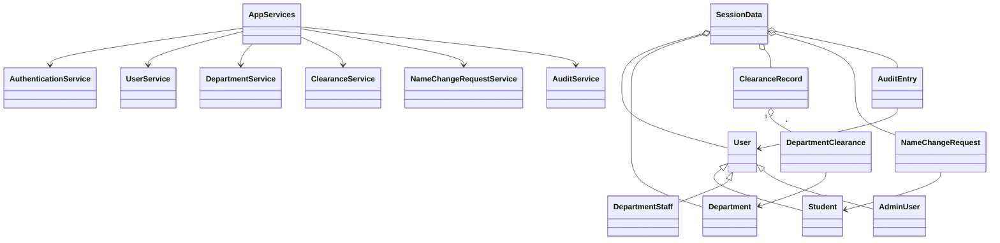

# CCC-ACT Project Documentation

## Problem Statement

Manual clearance tracking can be slow, unclear, and difficult to audit. CCC-ACT demonstrates a desktop system where students can monitor clearance progress, department staff can review assigned requests, and administrators can configure and manage the process.

## Objectives

- Provide a functional Java Swing clearance tracker.
- Enforce role-based access for students, staff, and administrators.
- Demonstrate OOP, MVC-style separation, validation, audit logging, and secure password hashing.
- Keep the system suitable for a college final-project defense.

## Scope

Included:

- In-system account registration and management
- Temporary password workflow
- Department configuration
- Semester setup
- Bulk clearance generation
- Department approval, flagging, and re-review
- Student contact profile updates
- Displayed-name request approval
- In-memory audit history

Excluded:

- Database storage
- File persistence
- Online deployment
- Email or SMS notifications
- Report exports
- Integration with official college systems

## Use Cases

### Student

- Change first-login temporary password.
- View clearance cycles and department statuses.
- Read flagged remarks and return addressed entries to Pending.
- Edit contact number, email, and home address.
- Submit and monitor displayed-name change requests.

### Department Staff

- Sign in and change temporary password.
- View only assigned department entries.
- Search and filter records.
- Approve or flag Pending requests with remarks.
- Re-review addressed flagged entries.
- View authorized audit history.

### Administrator

- Manage accounts and issue temporary passwords.
- Register student accounts inside the authenticated system.
- Create staff accounts and assign departments.
- Manage authoritative student records.
- Configure departments and active semester.
- Generate clearance records in bulk.
- Review name-change requests.
- View all records and audit history.

## UML Class Diagram



## OOP Decisions

- `User` is an abstract base class with role-specific subclasses.
- `Student`, `DepartmentStaff`, and `AdminUser` encapsulate role-specific data.
- Services own business rules so Swing event handlers remain thin.
- `SessionData` owns authoritative in-memory collections.
- `ClearanceRecord` derives progress and overall status from its entries.
- Department requirements are snapshotted into generated clearance entries so historical records keep their original rules.

## Screen Descriptions

- `LoginFrame`: sign in, student registration, forgotten-password instructions.
- `TemporaryPasswordDialog`: first-login password change.
- `StudentDashboardPanel`: clearance, profile, name-change requests, audit.
- `StaffDashboardPanel`: assigned queue review and authorized audit.
- `AdminDashboardPanel`: summary, accounts, students, configuration, generation, all records, name requests, audit.
- `PasswordPanel`: authenticated password change for all roles.

## Testing Plan and Results

The project includes `tests.BusinessLogicTest`, a plain Java test runner covering:

- Password verification and first-login change enforcement
- Duplicate username rejection
- Department access restrictions
- Clearance generation and duplicate prevention
- Required/optional progress rules
- Flagged re-review workflow
- Name-change approval and rejection
- Audit recording
- Semester/historical-cycle behavior
- Fresh demo session reset

Run it with:

```powershell
C:\Users\Admin\.jdks\openjdk-25.0.1\bin\java.exe -cp out tests.BusinessLogicTest
```

## Known Limitations and Future Enhancements

- Add database-backed persistence.
- Add official department verification.
- Add exportable reports.
- Add notification channels.
- Add richer UI styling and icons if allowed by project constraints.
